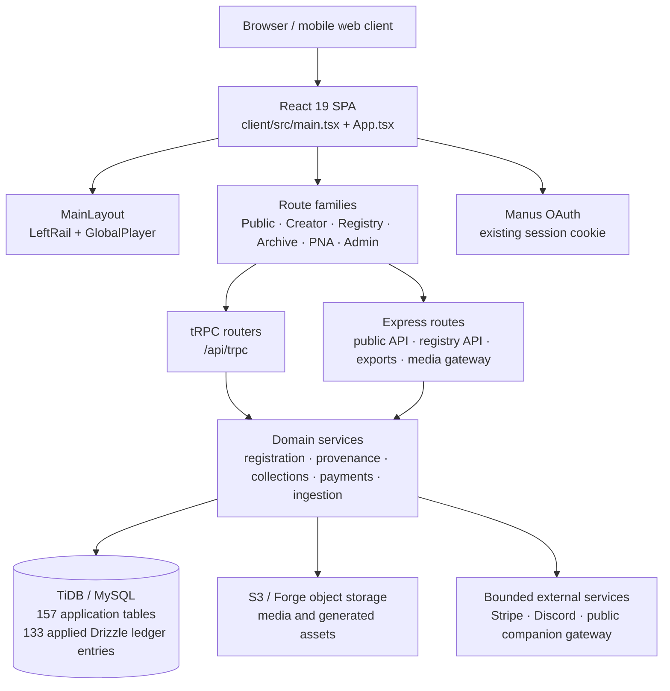

# Living Nexus — Application Dependency Map

**Captured:** 2026-10-26
**Source baseline:** `ee98767f5f21e631deb899b5b160bd2a9dd405e9` on `review/global-player-cinematic-phase1`
**Purpose:** A traceable map of the current Living Nexus application for recovery, product-identity work, information-architecture decisions, and UX/UI improvements.
**Boundary:** Living Nexus application only. Do not use this map to merge, modify, or assume responsibility for independently developed Jellyfin source, databases, hosts, packages, or releases.

## 1. System relationship overview

The diagram is an application dependency map, not a claim that every route or integration has been accepted end to end in production.

## 2. Canonical runtime composition

| Layer | Current source authority | Depends on | Preserved boundary |
| --- | --- | --- | --- |
| Browser bootstrap | `client/src/main.tsx` | React Query, tRPC client, OAuth return handling, `PlayerProvider`, `WorkEditorProvider` | Does not directly query the database or storage. |
| Route composition | `client/src/App.tsx` | `wouter`, lazy pages, redirect decisions, PNA router | Routes choose UI surfaces; they do not become alternate registry authorities. |
| Shared application shell | `client/src/components/layout/MainLayout.tsx` | `LeftRail`, Context/Right rail state, `GlobalPlayer`, responsive tokens | `LeftRail` is the navigation authority across desktop/mobile; shell mounts the canonical Global Player once. |
| Playback authority | `client/src/contexts/PlayerContext.tsx`, `client/src/components/player/GlobalPlayer.tsx` | canonical Work metadata, queue state, media access | Do not add a second Living Nexus audio engine or parallel queue. |
| Creator edit authority | `client/src/contexts/WorkEditorContext.tsx`, canonical Work/editor pages | protected `songs` procedures and canonical Work records | Creator Studio is a same-origin composition hub, not a second writer/database. |
| Server entry | `server/_core/index.ts` | Express middleware, OAuth, routes, tRPC, static/Vite server | The server composes routes; business rules reside in routers, domains, services, and DB helpers. |
| Persistence | `drizzle/schema.ts`, migrations, `server/utils/db.ts`, domain repositories | configured TiDB/MySQL database | One canonical application database / Registry-related data authority. |

## 3. User-facing route families

### Public discovery, record, and playback

| Route family | Main component / handler | Primary data/service dependencies |
| --- | --- | --- |
| `/`, `/home` | `HomePage` | public discovery projections, shared layout, public Works |
| `/explore`, `/search` | `ExplorePage`, `SearchResultsPage` | discovery/search routers and public Work/Creator projections |
| `/song/:id`, `/songs/:id` | canonical Work / Song Detail route | `songs` reads, Work identity, creator attribution, provenance history, Global Player |
| `/creator/:id`, creator-handle domain route | Creator profile/domain shell | profile, published Work, collections, witnessing and public attribution |
| `/witness-registry` | `WitnessRegistryPage` | `witnessRegistry` public paginated search across public WID-bearing Works |
| `/verify`, `/verify/:witnessId` | `VerifyPage` | public Registry / WID verification reads |
| `/album/:collectionWid`, `/collection/:slug`, `/playlists` | album, collection, playlist pages | canonical collection/playlist relationships; published Work projections |

### Registration, Creator, and preservation surfaces

| Route family | Main component / handler | Primary data/service dependencies |
| --- | --- | --- |
| `/manifest`, `/upload` | `ManifestationStudio`; guarded legacy upload entry | authentication, registration inputs, audio metadata review, draft hydration |
| `/archive`, `/my-archive/export` | `ArchivePage`, `CreatorDataExportPage` | creator-owned history, archive/export routes, S3/media fetches |
| `/manage`, `/studio` | `LoopManagePage`, `CreatorStudioHome` | same-origin Creator workflow links, `WorkEditorContext`, identity, payouts, exports |
| `/creator/collections`, `/studio/release/:id` | `CollectionsWorkspacePage` | owner-only Draft Releases, legacy WID-ALB projection/recovery, named playlists |
| `/studio/collection/:id` | `CollectionStudioPage` | legacy collection presentation editing boundary |
| `/settings/payouts` | `PayoutsPage` | owner profile/payment state and Stripe Connect onboarding gateway |

### PNA, identity, and operations

| Route family | Main component / handler | Primary data/service dependencies |
| --- | --- | --- |
| `/pna`, `/settings/stewardship` | `PNAServiceRouter` / PNA shell | authenticated threads, Context Envelope, Quiver/artifact records; AI operations remain paused |
| `/profile`, `/identity/:id`, `/settings/*` | profile, identity, billing, playback, payment settings pages | user/profile/creator settings and payment integration state |
| `/admin/*` | admin pages | protected admin routers, audit/moderation/payment integrity controls |
| `/developers`, `/developer` | developer/API surfaces | public API documentation and Registry access contracts |

### Redirects and legacy surfaces to preserve during UX work

`App.tsx` contains intentional redirects for retired or consolidated routes: `/discover → /`, legacy `/book/:id/studio → /manage`, selected `/archive/*` paths → `/archive`, `/dashboard → /manage`, and selected visual/project routes → their current canonical destinations. Treat these as compatibility behavior until a separately approved retirement plan exists.

## 4. Data domains and principal schema relationships

The current database contains 157 base tables. The following groups are useful for product/UX work; they are not an exhaustive replacement for `drizzle/schema.ts`.

| Data domain | Representative tables / records | Supports |
| --- | --- | --- |
| Identity and creator profile | `users`, name history, creator platforms, creator contact settings | creator domains, identity editing, public attribution, permissions |
| Canonical Work / Registry | `songs`, `wids`, `workEvents`, `workLineage`, `workEvidence`, provenance/declaration records | Work pages, WIDs, Registry verification, history, participation, media eligibility |
| Social / witnessing / conversations | witnesses, subscriptions, comments, mentions, correspondence, notifications, reactions | Witnessing Circle, Voices, comments, creator relationships |
| Collections | playlists and playlist membership/version tables; legacy collections; Release Family / Draft / edition tables | named playlists, Draft Releases, legacy WID-ALB preservation, future edition hold |
| Registration / ingestion | manifestation sessions/events, batch upload tables, core-ingestion tables, evidence/asset records | music-first registration, metadata review, private drafts, operator queues |
| Archive and distribution | downloads, licenses, export routes, share artifacts, physical export records | creator preservation export, licensed download, archive and portability flows |
| Support and payments | tips, payments, creator payment settings, reconciliation logs, Stripe state | tips, support flows, payouts and related notices |
| PNA workspace | PNA threads/messages, Context Envelopes, artifacts, Quiver, Keeper records | private creator workspace; does not independently publish/alter a Work |
| Governance / administration | audit logs, Registry API clients/credentials/scopes, moderation, admin notifications | operator controls, Registry API, evidence/audit boundaries |

**Important invariants:** preserve Work IDs, WIDs, current media references, historical events, HAAI declarations, creator ownership/permissions, legacy WID-ALB seals, and the append-only relationships documented in existing ADRs and audits.

## 5. API and service boundaries

### tRPC application domain

`server/routers/index.ts` composes feature routers. Representative authoritative routers include:

- `songs`, `declaration`, `provenance`, `wids`, `witnessRegistry`, and `releaseDrafts` for Work/Registry/collection activity;
- `playlist` / `playlists` / `collections` / `collectionStudio` for relationship management;
- `profile`, `domain`, `tips`, `payments`, and `stripeWebhook` for identity and support;
- `comments`, `witness`, `witnessSubscription`, and `correspondence` for relationship/social actions;
- `batchUpload`, `coreIngestion`, `quiver`, and `onboarding` for registration and authoring workflows; and
- `admin`, `audit`, `moderation`, and `paymentIntegrity` for operator functions.

### Express routes

`server/_core/index.ts` mounts the REST-style application boundaries:

- OAuth callback and session handling;
- upload, download, creator export, bulk download, physical export, archive/database export routes;
- public catalog/verification/share/embed/OG/sitemap routes;
- Registry API routes with scoped access controls;
- Work route and media-related gateways;
- rate limits and global error handling.

### Storage and media

Media/file handling is server-mediated through storage helpers and current Work eligibility/permission checks. Public companion playback uses `server/routes/provenancePlayerMediaRoute.ts`, which rechecks current eligibility at media request time and should not be replaced with exposed raw storage URLs.

## 6. Existing external integration boundary

| Integration | Local Living Nexus dependency | Status / guard |
| --- | --- | --- |
| Manus OAuth | `server/_core/oauth.ts`, client login return paths | Existing application authentication authority. |
| TiDB / MySQL | Drizzle, database helpers, `DATABASE_URL` | Canonical persistence. Fresh snapshot/recovery rehearsal completed 2026-10-26. |
| S3 / Forge storage | storage helpers, media/upload/export paths | Stores/retrieves application artifacts; URLs and permissions must remain guarded. |
| Stripe | tips/payments/payouts routes | Connect/onboarding and support boundary; no financial acceptance claim is implied by this map. |
| Discord | router/service and UI links | Community integration; do not broaden during UI-only work. |
| Registry API | `server/routes/registryApiRoute.ts`, scoped credentials | Existing API boundary; preserve its scope/pepper/access policy. |
| Provenance Player | existing `living-nexus-player/1` adapter and revocable media gateway | Companion export path; no account synchronization, shared queue, or second registry authority. |
| External media clients | current public catalog endpoints and existing gateway rules | Application-local endpoints may serve eligible projections. **Do not treat this as ownership of independently developed Jellyfin code or infrastructure.** |
| AI/LLM/image/voice providers | shared availability control and provider helpers | Globally paused. Product/UX work must not reactivate operations without explicit approval. |

## 7. Design-system and responsive dependencies

| Concern | Primary files | Constraint for upcoming UX work |
| --- | --- | --- |
| Global visual tokens and typography | `client/src/index.css`, Cathedral design guidance | Use existing dark Cathedral tokens, accessibility/focus rules, and reduced-motion behavior; do not introduce disconnected visual systems. |
| Shared chrome | `MainLayout`, `LeftRail`, `TopBar`, `RightRail`, footer | One navigation authority; preserve desktop/mobile route parity and escape/back/focus behavior. |
| Mobile bottom stack | `GlobalPlayer`, `viewportLayers.ts`, mobile CSS tokens | One player/queue authority; preserve safe-area and viewport containment. |
| Creator identity / Work record | Creator Domain, `LoopWorkPage`, WID/Chain-of-Record components | Improvements must stay tied to canonical Work, Creator, and Registry fields. |
| Registration and studio | Manifestation Studio, Creator Studio hub, WorkEditorContext | Improve workflow clarity without duplicating mutations, state, or data authority. |

The 2026-10-22 mobile corrections validated a solid grouped drawer, 360px containment, and a compact persistent player locally. A physical-device acceptance pass remains a release-quality activity, not a reason to replace the established shell.

## 8. Runtime and deployment dependencies

| Operation | Current behavior | Preservation note |
| --- | --- | --- |
| Development | `pnpm dev` | Express/Vite development server with current environment configuration. |
| Production build | `pnpm build` | Builds Vite client and bundles Express server. Current build passes with an existing chunk-size warning. |
| Production start | `drizzle-kit migrate && NODE_ENV=production node dist/index.js` | The migration ledger must remain coherent; deployment is outside this World Save. |
| Schema authoring | `drizzle/schema.ts`, numbered `drizzle/*.sql`, journal | No automatic schema rework during UX/UI planning. |
| Tests | `pnpm test`, focused Vitest files | Current World Save run: 153 files / 930 passed, 1 skipped. |
| Type check | `pnpm check` | Passed at World Save. |

## 9. Current preserved risk register for the next session

The next product-identity / UX/UI session should preserve—not rediscover—the following known conditions:

1. PWA activation has a known visible timeout but no confirmed worker-side root cause. Keep evidence-first diagnosis; do not apply cache/timeout speculation.
2. Authenticated creator write acceptance for Studio, Draft Releases, HAAI corrections, manifest actions, archive export, and Player comments needs controlled staging-safe testing.
3. WID-ALB2 edition sealing and creator signing keys remain deferred.
4. The AI operation pause is active.
5. The application has historical overlapping management surfaces. Reduce workflow friction through IA and presentation work only after tracing each surface to its canonical authority.
6. The World Save does not claim an exact production server commit or authorize a deployment.

## 10. Change-safety guide for product identity and UX/UI work

Before changing a page, identify:

1. its route in `client/src/App.tsx`;
2. its shared shell / responsive layer ownership;
3. the router or route handler supplying its data;
4. the canonical database/Registry object it represents;
5. whether the page is an active authority, a compatibility redirect, or a dormant legacy source file; and
6. relevant focused contracts before changing visual or interaction behavior.

For all product identity work, retain these application principles:

- Preserve / Attribute / Discover / Support;
- people and Works, not generic “content” abstractions;
- one canonical Work and Registry record;
- one playback authority;
- source-backed claims about capability and deployment state; and
- mobile containment, keyboard focus, and reduced-motion support as first-class UI requirements.

## 11. Evidence pointers

- Application route map: `client/src/App.tsx`
- Runtime mount: `client/src/main.tsx`, `server/_core/index.ts`
- Schema: `drizzle/schema.ts`
- Migrations and journal: `drizzle/*.sql`, `drizzle/meta/_journal.json`
- Current known debt: `refinement/debt.ts`
- World Save / recovery evidence: `docs/lnls/audits/WORLD-SAVE-APPLICATION-RECOVERY-2026-10-26.md`
- Prior release stabilization: `docs/lnls/audits/RELEASE-STABILIZATION-ARCHIVE-DRAFT-AND-PWA-2026-10-21.md`
- Creator Studio decision: `docs/lnls/adr/CREATOR-STUDIO-EXTRACTION-ASSESSMENT-2026-10-21.md`
